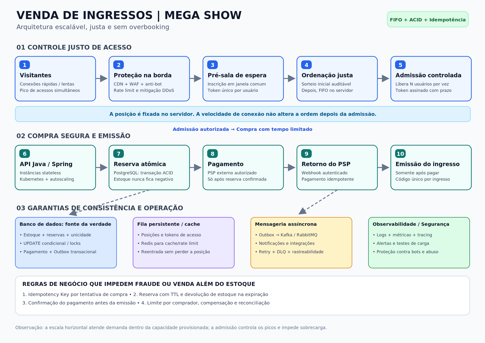

# Arquitetura de venda de ingressos de alta concorrência



## Objetivo

Atender um pico de acessos significativamente maior que a quantidade de ingressos disponíveis, sem venda acima do estoque, mantendo o acesso justo e evitando que diferenças de velocidade de conexão determinem a ordem após a entrada na fila.

## Decisões principais

1. **Proteção e escala:** CDN, WAF, mitigação de bots/DDoS e rate limiting na borda. APIs stateless em múltiplas réplicas, com escalabilidade horizontal e observabilidade.
2. **Justiça na admissão:** inscrição em uma janela comum antes da abertura da venda, seguida de sorteio auditável da ordem entre pré-inscritos; novas entradas depois dessa janela seguem FIFO. Um token único e assinado fixa a posição no servidor. Recarregar a página ou ter internet mais rápida não muda a posição estabelecida. A loteria é uma política de justiça proposta: suas regras e o horário de corte precisam ser divulgados ao público.
3. **Admissão controlada:** número limitado de sessões de compra por intervalo, determinado pela capacidade de reservas e pagamento. O sistema pode manter muitas pessoas na sala de espera sem sobrecarregar o banco e o PSP.
4. **Estoque como fonte da verdade:** PostgreSQL com transação ACID e atualização condicional do estoque (ou bloqueio explícito da linha), além de restrições de unicidade. A reserva só existe se houver unidades disponíveis; o banco, não o cache, decide a disponibilidade.
5. **Tempo de reserva:** a reserva tem TTL. Se não houver pagamento confirmado no prazo, o estoque é liberado por processo idempotente. Casos de corrida entre expiração e confirmação exigem máquina de estados transacional e reconciliação com o PSP.
6. **Pagamento seguro:** realizar a cobrança apenas após reserva bem-sucedida. Usar chave de idempotência e validar assinatura e unicidade dos webhooks do PSP. A emissão só acontece com pagamento confirmado e reserva válida; cada ingresso tem identificador único.
7. **Mensageria confiável:** Transactional Outbox para eventos de reserva e confirmação, seguida de publicação assíncrona em Kafka/RabbitMQ. Consumidores idempotentes, retry com backoff, DLQ e rastreabilidade. O PSP é uma dependência externa cuja capacidade também deve limitar a admissão.
8. **Monitoramento:** acompanhar comprimento e tempo de espera, taxa de admissão, reservas expiradas, estoque, conflitos de concorrência, aprovação de pagamentos, latência P95/P99, erros e filas de eventos.

## Exemplo conceitual de reserva atômica

```sql
BEGIN;
UPDATE lotes_ingressos
   SET disponiveis = disponiveis - :quantidade
 WHERE evento_id = :evento_id
   AND disponiveis >= :quantidade;
-- Somente criar a reserva se a atualização afetou 1 linha.
-- Criar a reserva com uma chave idempotente única e registrar o evento na Outbox.
COMMIT;
```

A aplicação deve tratar o caso de atualização de zero linhas como **estoque insuficiente**. Em produção, também são necessários mecanismos para manter a transação consistente diante de falhas, conflitos e duplicidade de requisições.

## Limite da garantia

Nenhuma arquitetura suporta demanda literalmente infinita. A sala de espera e o rate limiting controlam o volume admitido; os recursos são provisionados com testes de carga e capacidade. A justiça começa quando o token é registrado e ordenado pelo servidor; a rede do usuário ainda pode afetar sua capacidade de se conectar inicialmente.
